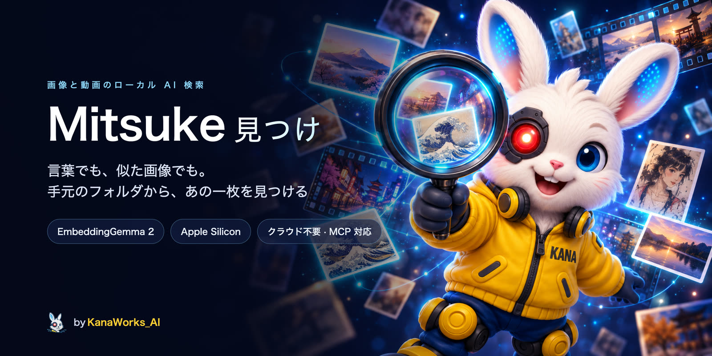
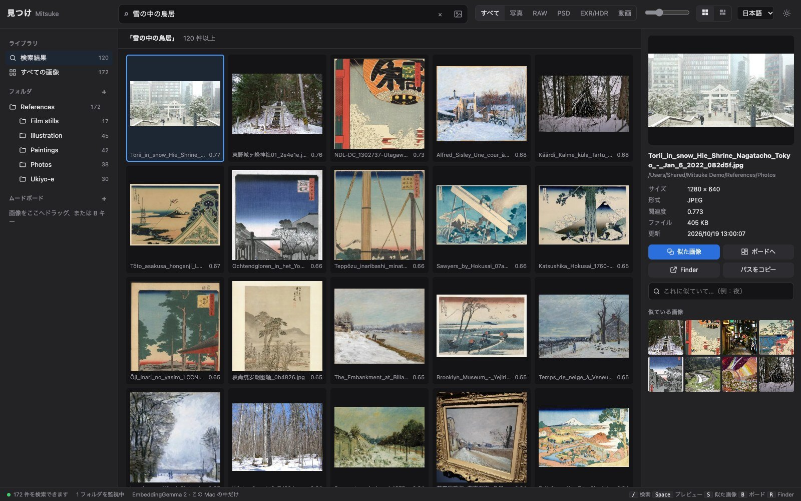
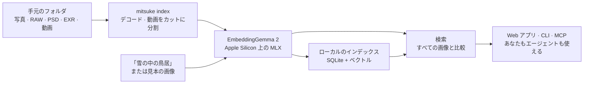

<div align="center">



<p>
  <a href="LICENSE"></a>
  
  <a href="https://modelcontextprotocol.io"></a>
  
  <a href="https://github.com/kanaworksai-hue/mitsuke/actions/workflows/tests.yml"></a>
  <a href="https://github.com/kanaworksai-hue/mitsuke/stargazers"></a>
</p>

<p><a href="https://github.com/kanaworksai-hue"></a>&nbsp;<a href="https://github.com/kanaworksai-hue"><b>A KanaWorks_AI project</b></a></p>

[English](README.md) | [简体中文](README.zh-CN.md) | **日本語**

[クイックスタート](#-クイックスタート) · [エージェントから使う](#-エージェントから使う) · [Web アプリ](#%EF%B8%8F-web-アプリ) · [コマンド](#-コマンド) · [FAQ](#-faq) · [⭐ Star](#-気に入ったら-star-を)

</div>

**Mitsuke 見つけ** は、イラストレーター、アーティスト、映像制作者のための、画像と動画のローカル AI 検索ツールです。日本語、英語、中国語など多くの言語で、「雪の中の鳥居」「foggy bridge at dawn」「云雾缭绕的水墨山水」のように言葉で説明するだけで探せます。画像を見せて「これに似た感じで、夜の画像」と探すこともできます。写真、カメラ RAW、PSD、EXR / HDR、そして動画の中の該当するカットまで、手元のフォルダから見つけます。Google の [EmbeddingGemma 2](https://huggingface.co/google/embeddinggemma-2) がすべて Mac 上で動くので、画像が Mac の外に出ることはありません。

ローカルの Web アプリやコマンドラインで使えるほか、MCP 経由で AI エージェント（Claude Code、Codex、Cursor など）に探してもらうこともできます。

<p align="center">
  
  <br><sub>パブリックドメインの画像で作った資料フォルダを検索しているところ。写真と並んで雪景色の浮世絵も出てきます。ファイル名ではなく、写っている内容で探しているからです。</sub>
</p>

## ✨ 特長

<table>
<tr>
<td align="center" width="25%">🔎<br><b>意味で探す</b><br><sub>言葉でも、見本の画像でも、その組み合わせでも。バランスはスライダーで調整</sub></td>
<td align="center" width="25%">🎞️<br><b>現場の素材フォルダに対応</b><br><sub>RAW、PSD / PSB、EXR / HDR、HEIC。動画はカット単位で検索</sub></td>
<td align="center" width="25%">🤖<br><b>エージェント対応</b><br><sub>MCP サーバー、JSON 出力の CLI、スキル。エージェントが探して見せてくれます</sub></td>
<td align="center" width="25%">🔒<br><b>ローカル</b><br><sub>Apple Silicon 上の MLX で動作。アカウント、アップロード、API キーは不要</sub></td>
</tr>
</table>

- **フォルダの変化に追従：** Web アプリか `mitsuke index --watch` が動いている間は、新しいファイルや変更されたファイルを自動でインデックスに追加します。移動や名前の変更は同じファイルとして認識し、インデックスを作り直しません。
- **ムードボード：** 検索結果をムードボードに集めて、「このボードに似た画像」を探せます。
- **ファイルには手を加えない：** Mitsuke は読むだけです。インデックスとサムネイルは別のフォルダに保存します。

## 🧭 しくみ



画像と言葉は同じ埋め込み空間に置かれるので、文章でも画像でも、その組み合わせでも、ライブラリ内のすべての画像と比較できます。

## 🚀 クイックスタート

**必要なもの：**

- Apple Silicon の Mac（M1 以降）
- [`uv`](https://docs.astral.sh/uv/)（`brew install uv`）。Python は uv が用意します。
- ディスクの空き容量 約 4 GB（モデルが約 1.5 GB、残りはパッケージとインデックス）

> [!TIP]
> **エージェントにインストールしてもらう。** Claude Code、Codex などのコーディングエージェントにこう頼んでください：
> 「https://github.com/kanaworksai-hue/mitsuke の INSTALL.md に従って Mitsuke をインストールして」
>
> エージェントは [`INSTALL.md`](INSTALL.md) に従って、Mac の環境確認、`mitsuke` コマンドのインストール、モデルのダウンロードを行い、どのフォルダを検索対象にするかをあなたに確認します。CLI と MCP サーバーのどちらを使うかは自分で判断し、スキルをインストールして、最後に Web アプリの開き方を案内してくれます。

自分でインストールする場合：

```bash
uv tool install "mitsuke @ git+https://github.com/kanaworksai-hue/mitsuke"
mitsuke doctor --download      # 環境を確認し、モデルをダウンロード（初回のみ）
mitsuke serve --open           # Web アプリ（http://127.0.0.1:8737）を開く。フォルダはここで追加
```

Web アプリを使わず、コマンドラインだけで使う場合：

```bash
mitsuke add ~/Pictures/References ~/Work/Concept
mitsuke index                  # Ctrl-C で止めても、もう一度実行すれば続きから
mitsuke search "雪の中の鳥居"
mitsuke similar ~/Desktop/this_composition.jpg
```

## 🤖 エージェントから使う

インストールしたら、あとは頼むだけです：「日本旅行のフォルダから霧の港の写真を探して」「ろうそくの明かりに照らされた室内の資料を集めて、良いものをムードボードに入れて」「動画からドラゴンが出てくるカットを探して」。エージェントは次のどれかを使います：

- **MCP サーバー：** `mitsuke mcp`（stdio）。一度読み込んだモデルをメモリに保持するので、2 回目以降の検索は速くなります。

  ```bash
  claude mcp add --scope user mitsuke -- "$(command -v mitsuke)" mcp   # Claude Code
  codex mcp add mitsuke -- "$(command -v mitsuke)" mcp                 # Codex
  ```

  ツール：`search`（言葉、見本の画像、ムードボード、その組み合わせ）、`similar`、`view_images`（エージェントが見られるコンタクトシート）、`file_info`、`open_file`、ムードボード用のツール 7 つ、`status`、`add_folder`、`remove_folder`、`index`、`web_link`。
- **CLI：** すべてのコマンドが `--json` に対応しています。例：`mitsuke search "夜" --like 12 --json`。
- **スキル：** `mitsuke skill install` で `~/.claude/skills/mitsuke` にスキルをインストールします。どんなときに Mitsuke を使うか、結果をどう見せるか（同じ検索を Web アプリで開くリンクも添える）をエージェントに伝えます。

<details>
<summary><b>Claude Desktop、Cursor などの MCP クライアント</b></summary>

コマンドは絶対パスで指定してください（デスクトップアプリはシェルの `PATH` を参照しません）：

```json
{ "mcpServers": { "mitsuke": { "command": "/Users/<you>/.local/bin/mitsuke", "args": ["mcp"] } } }
```

シェルで `HF_HOME` や `MITSUKE_HOME` を設定している場合は、`"env"` にも同じ値を入れてください。ダウンロード済みのモデルとインデックスをサーバーが見つけられるようになります。
</details>

## 🖼️ Web アプリ

`mitsuke serve --open` で起動します。`127.0.0.1` だけで待ち受け、起動中はインデックスを常に最新の状態に保ちます。画面は日本語、英語、中国語に対応し、ダークとライトのテーマがあります。

- **検索欄はひとつ：** どの言語でも入力でき（普段お使いの音声入力も利用できます）、画像をドロップ、貼り付け、選択することもできます。画像と言葉を組み合わせて（「この構図」＋「夜」）、スライダーで両者のバランスを調整できます。
- **動画：** 動画はカットごとに分割してインデックスを作成します。検索すると該当するカットから再生します。
- **ムードボード：** 結果をムードボードにドラッグ（または <kbd>B</kbd> キー）し、ボード全体に似た画像を探せます。
- **作業しやすい操作：** 正方形のグリッドと元の比率の行表示、サムネイルサイズのスライダー、全画面プレビュー（<kbd>Space</kbd>）、矢印キーで移動、<kbd>S</kbd> で似た画像を検索、<kbd>R</kbd> で Finder に表示、フォルダやファイル形式での絞り込み。Chrome や Edge では、結果を Finder にドラッグすると元のファイルのコピーを保存できます。

## 📋 コマンド

| コマンド | 内容 |
|---|---|
| `mitsuke add <folder>…` / `remove <folder>…` / `roots` | ライブラリのフォルダを管理（外してもファイルそのものは消えません） |
| `mitsuke index [--watch] [--quality fast\|default\|best]` | 新しいファイルや変更されたファイルのインデックスを作成。`--watch` で動かし続けて変化に追従 |
| `mitsuke search "<text>" [-k 20] [--root F] [--kind raw,psd,exr,video]` | 言葉で画像（と動画のカット）を探す |
| `mitsuke search ["<text>"] [--like <image>…] [--board ID] [--text-weight 0.5]` | 画像＋言葉（「これに似ていて、夜」）、またはムードボード全体で探す |
| `mitsuke similar <image or id>` | 見た目が似た画像を探す（ライブラリ外の画像でも可） |
| `mitsuke board list\|create\|show\|add\|remove\|rename\|delete` | ムードボード（Web アプリと共通） |
| `mitsuke show <image or id> [--open\|--reveal]` | ファイルの詳細。開く、または Finder に表示 |
| `mitsuke web ["<text>"] [--board ID] [--start] [--open]` | 検索やムードボードを Web アプリで開くリンクを出力（`--start` でアプリをバックグラウンド起動） |
| `mitsuke serve [--port 8737] [--open] [--no-index]` | Web アプリ（ローカルのみ）。バックグラウンドでフォルダのインデックス作成と監視も行う |
| `mitsuke mcp` | AI エージェント向けの MCP サーバー（stdin/stdout） |
| `mitsuke skill install [--dir D]` | エージェント用スキルをインストール（既定は `~/.claude/skills`） |
| `mitsuke status` | インデックス済み、未処理、失敗の件数 |
| `mitsuke doctor [--download]` | Python、デコーダー、モデル、ディスク、フォルダを確認 |

すべてのコマンドが、エージェントやスクリプト向けの `--json` に対応しています（`index` は 1 行に 1 つの JSON イベントを出力）。

<details>
<summary><b>対応フォーマット</b></summary>

JPEG、PNG、WebP、HEIC / HEIF、AVIF、TIFF（16 bit を含む）、GIF、BMP、TGA、JPEG 2000、PSD / PSB、カメラ RAW（CR2、CR3、NEF、ARW、RAF、ORF、RW2、DNG など）、OpenEXR と Radiance HDR（トーンマップして検索）、動画（MP4、MOV、M4V、MKV、WebM、AVI。カット単位で検索）。
</details>

<details>
<summary><b>データの保存場所</b></summary>

- インデックス：`~/Library/Application Support/Mitsuke`
- サムネイル：`~/Library/Caches/Mitsuke`
- モデル：Hugging Face のキャッシュ（`~/.cache/huggingface`。`HF_HOME` を設定している場合はそちら）

`MITSUKE_HOME=<folder>` を設定すると、インデックスとサムネイルを別の場所に保存できます。
</details>

## ❓ FAQ

<details>
<summary><b>何かがアップロードされますか？</b></summary>

いいえ。画像、検索内容、インデックスはすべて Mac の中にとどまります。インストール時に Python のパッケージを、初回に Hugging Face からモデルをダウンロードします。その後は、モデルを読み込むときに Hugging Face のライブラリがモデルの更新を確認します（`HF_HUB_OFFLINE=1` で無効にできます）。Web アプリは `127.0.0.1` だけで待ち受けます。
</details>

<details>
<summary><b>Windows、Linux、Intel Mac で動きますか？</b></summary>

現時点では対応していません。モデルを [MLX](https://github.com/ml-explore/mlx) で動かしているため、Apple Silicon の Mac が必要です。
</details>

<details>
<summary><b>どの言語で検索できますか？</b></summary>

EmbeddingGemma 2 は多言語モデルです。日本語、英語、中国語で問題なく検索でき、混ぜて使っても大丈夫です。声で検索したいときは、Mac の音声入力などお好きなツールを使ってください。
</details>

<details>
<summary><b>動画の音声やセリフでも検索できますか？</b></summary>

できません。動画は画面に映っている内容で、カットごとに検索します。
</details>

<details>
<summary><b>エージェントには CLI と MCP のどちらを使わせるべきですか？</b></summary>

エージェントのアプリが MCP に対応していて、よく検索するなら MCP です。モデルが読み込まれたままになります（セッション中は数 GB のメモリを使います）。CLI は呼び出しごとにモデルを読み込みます（数秒）が、何も常駐しません。エージェントが判断に使う基準は [`INSTALL.md`](INSTALL.md) にあります。
</details>

## 🗺️ ロードマップ

- [x] 言葉、画像、画像＋言葉での検索。動画のカット単位検索。EXR / HDR
- [x] Web アプリ、CLI、MCP サーバー、エージェント用スキル
- [ ] 色で絞り込む
- [ ] PNG に埋め込まれた ComfyUI / Automatic1111 のプロンプトをインデックス化
- [ ] ムードボードの書き出し

Issue や Pull Request を歓迎します。

## ⭐ 気に入ったら Star を

Mitsuke で探していた画像が見つかったら、[リポジトリのページ](https://github.com/kanaworksai-hue/mitsuke)右上の **⭐ Star** を押していただけるとうれしいです。ワンクリックで済みますが、思っている以上に大きな支えになります。

- **より多くの人に届きます。** Star が増えると GitHub で見つけてもらいやすくなり、より多くのアーティストや映像制作者に使ってもらえます。
- **アップデートが続きます。** Star が増えるたびに「誰かの役に立っている」と分かり、次の機能を作る励みになります。

バグ報告や要望は [Issue](https://github.com/kanaworksai-hue/mitsuke/issues) へどうぞ。X で [@KanaWorks_AI](https://x.com/KanaWorks_AI) をつけて使い方をシェアしてもらえるのも大歓迎です。

## 🛠️ 開発

```bash
uv sync
uv run pytest              # ダミーの埋め込みモデル（fake embedder）を使うオフラインテスト。モデルや GPU は不要
uv run pytest -m model     # 実モデルでのテスト
uv run mitsuke serve       # チェックアウトから起動
```

```
src/mitsuke/
  cli.py        コマンド（argparse、すべて --json 対応）
  indexer.py    走査 → 埋め込み。途中から再開でき、移動や名前の変更ではベクトルを引き継ぐ
  search.py     コサイン検索、画像＋言葉の融合、絞り込み
  server.py     ローカルの Web アプリ（標準ライブラリの HTTP サーバー）
  mcp.py        MCP サーバー（stdio JSON-RPC）
  video.py      カット検出とカットのサムネイル
  decode.py     RAW / PSD / EXR / HDR / HEIC のプレビュー
  web/          Web アプリ（素の JS、ビルド不要）
  skill/        エージェント用スキル
```

## 📄 ライセンスとクレジット

- **このプロジェクト：** [MIT](LICENSE)。
- **モデル：** Google の [EmbeddingGemma 2](https://huggingface.co/google/embeddinggemma-2)（Apache 2.0）。Hugging Face からダウンロードします（[MLX 変換版](https://huggingface.co/mlx-community/embeddinggemma-2-bf16)）。このリポジトリには含まれていません。
- **使用技術：** [MLX](https://github.com/ml-explore/mlx)、[mlx-vlm](https://github.com/Blaizzy/mlx-vlm)、[OpenCV](https://opencv.org)、[Pillow](https://python-pillow.org)、[rawpy](https://github.com/letmaik/rawpy)、[psd-tools](https://github.com/psd-tools/psd-tools)、[Model Context Protocol](https://modelcontextprotocol.io)。
- **スクリーンショット：** デモ用ライブラリの画像は、Wikimedia Commons のパブリックドメインおよび CC0 の作品です（[一覧](docs/assets/demo-credits.md)）。
- **ブランド：** KanaWorks_AI の名称、ロゴ、キャラクター Kana の権利は KanaWorks_AI に帰属し、MIT ライセンスの対象**外**です。[docs/brand](docs/brand/README.md) を参照してください。

本プロジェクトは独立したものであり、Google、Apple、Anthropic との提携関係はなく、各社の公認を受けたものでもありません。

<br>

<div align="center">

<a href="https://x.com/KanaWorks_AI"></a>

<p><b>Made with ♥ by <a href="https://x.com/KanaWorks_AI">KanaWorks_AI</a></b></p>

<p><sub>Mitsuke が役に立ったら、ぜひ ⭐ を。アップデートを続ける励みになり、ほかの人に見つけてもらうきっかけにもなります。ほかのプロジェクト：<a href="https://github.com/kanaworksai-hue">github.com/kanaworksai-hue</a></sub></p>

</div>
