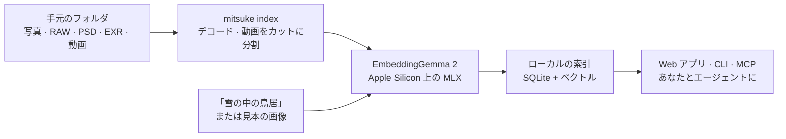

<div align="center">


<p>
  <a href="LICENSE"></a>
  
  <a href="https://modelcontextprotocol.io"></a>
  
  <a href="https://github.com/kanaworksai-hue/mitsuke/actions/workflows/tests.yml"></a>
  <a href="https://github.com/kanaworksai-hue/mitsuke/stargazers"></a>
</p>

<p><a href="https://github.com/kanaworksai-hue"></a>&nbsp;<a href="https://github.com/kanaworksai-hue"><b>A KanaWorks_AI project</b></a></p>

[English](README.md) | [简体中文](README.zh-CN.md) | **日本語**

[クイックスタート](#-クイックスタート) · [エージェントから使う](#-エージェントから使う) · [Web アプリ](#%EF%B8%8F-web-アプリ) · [コマンド](#-コマンド) · [FAQ](#-faq) · [⭐ Star](#-気に入ったら-star-を)

</div>

**Mitsuke 見つけ** は、イラストレーター、アーティスト、映像制作者のためのローカル AI 画像検索です。「雪の中の鳥居」「foggy bridge at dawn」「云雾缭绕的水墨山水」のようにどの言語でも言葉で探せますし、画像を見せて「これに似ていて、夜のもの」と探すこともできます。写真、カメラ RAW、PSD、EXR / HDR、そして動画の中の該当するカットまで、手元のフォルダから見つけます。Google の [EmbeddingGemma 2](https://huggingface.co/google/embeddinggemma-2) が Mac 上で動くので、画像が Mac の外に出ることはありません。

ローカルの Web アプリ、コマンドライン、そして MCP 経由で AI エージェント（Claude Code、Codex、Cursor など）から使えます。

<p align="center">
  
  <br><sub>パブリックドメインの画像で作った資料フォルダを検索しているところ。写真と並んで雪景色の浮世絵も出てきます。ファイル名ではなく、画像の内容で探しているからです。</sub>
</p>

## ✨ 特長

<table>
<tr>
<td align="center" width="25%">🔎<br><b>意味で探す</b><br><sub>どの言語の言葉でも、見本の画像でも、両方でも。比率はスライダーで調整</sub></td>
<td align="center" width="25%">🎞️<br><b>実務の素材フォルダに</b><br><sub>RAW、PSD / PSB、EXR / HDR、HEIC、動画はカット単位で検索</sub></td>
<td align="center" width="25%">🤖<br><b>エージェント対応</b><br><sub>MCP サーバー、JSON 出力の CLI、skill。エージェントが探して見せてくれます</sub></td>
<td align="center" width="25%">🔒<br><b>ローカル</b><br><sub>Apple Silicon 上の MLX で動作。アカウント、アップロード、API キーは不要</sub></td>
</tr>
</table>

- **フォルダの変化に追従：** 新しいファイル、変更、移動、名前の変更を拾います。移動や名前の変更は同じファイルとして認識し、索引を作り直しません。
- **ムードボード：** 検索結果をボードに集めて、「このボードに似たもの」を探せます。
- **ファイルには手を加えない：** Mitsuke は読むだけです。索引とサムネイルは別のフォルダに置きます。

## 🧭 しくみ



画像と言葉は同じ埋め込み空間に入るので、文章でも、画像でも、その組み合わせでも、ライブラリのすべての画像と比べられます。

## 🚀 クイックスタート

**必要なもの：**

- Apple Silicon の Mac（M1 以降）
- [`uv`](https://docs.astral.sh/uv/)（`brew install uv`）。Python は uv が用意します。
- 空きディスク約 4 GB（モデルが約 1.5 GB、残りはパッケージと索引）

> [!TIP]
> **エージェントにインストールしてもらう。** Claude Code、Codex などのコーディングエージェントにこう頼んでください：
> *「https://github.com/kanaworksai-hue/mitsuke の INSTALL.md に従って Mitsuke をインストールして」*
>
> エージェントは [`INSTALL.md`](INSTALL.md) に従って、Mac の確認、`mitsuke` コマンドのインストール、モデルのダウンロードをし、どのフォルダを索引するかをあなたに聞き、CLI と MCP サーバーのどちらを使うかを自分で選び、skill を入れて、Web アプリの開き方を教えてくれます。

自分でインストールする場合：

```bash
uv tool install "mitsuke @ git+https://github.com/kanaworksai-hue/mitsuke"
mitsuke doctor --download      # 環境を確認し、モデルをダウンロード（初回のみ）
mitsuke serve --open           # Web アプリ http://127.0.0.1:8737 。フォルダはここで追加
```

コマンドラインだけで使う場合：

```bash
mitsuke add ~/Pictures/References ~/Work/Concept
mitsuke index                  # Ctrl-C で止めても、もう一度実行すれば続きから
mitsuke search "雪の中の鳥居"
mitsuke similar ~/Desktop/this_composition.jpg
```

## 🤖 エージェントから使う

インストールしたら、あとは頼むだけです：「去年の旅行で撮った霧の港の写真を探して」「ろうそくの灯りの室内の参考資料を集めて、良いものをボードに入れて」「動画の中でドラゴンが出てくるカット」。エージェントは次のどれかを使います：

- **MCP サーバー：** `mitsuke mcp`（stdio）。モデルが呼び出しの間も読み込まれたままなので、2 回目以降の検索は速くなります。

  ```bash
  claude mcp add --scope user mitsuke -- "$(command -v mitsuke)" mcp
  ```

  ツール：`search`（言葉、見本の画像、ムードボード、その組み合わせ）、`similar`、`view_images`（エージェントが見られるコンタクトシート）、`file_info`、`open_file`、ムードボード用のツール、`status`、`add_folder`、`remove_folder`、`index`、`web_link`。
- **CLI：** すべてのコマンドが `--json` に対応しています。例：`mitsuke search "at night" --like 12 --json`。
- **Skill：** `mitsuke skill install` で `~/.claude/skills/mitsuke` に skill を入れます。いつ Mitsuke を使うか、結果をどう見せるか（Web アプリで同じ検索を開くリンク付き）をエージェントに教えます。

<details>
<summary><b>Claude Desktop、Cursor などの MCP クライアント</b></summary>

コマンドは絶対パスで指定してください（デスクトップアプリはシェルの `PATH` を見ません）：

```json
{ "mcpServers": { "mitsuke": { "command": "/Users/<you>/.local/bin/mitsuke", "args": ["mcp"] } } }
```

シェルで `HF_HOME` や `MITSUKE_HOME` を設定している場合は、`"env"` にも同じ値を入れてください。ダウンロード済みのモデルと索引をサーバーが見つけられるようになります。
</details>

## 🖼️ Web アプリ

`mitsuke serve --open` で起動します。`127.0.0.1` だけで待ち受け、起動している間は索引を最新に保ちます。画面は日本語、英語、中国語に対応し、ダークとライトのテーマがあります。

- **検索欄はひとつ：** どの言語でも入力でき（お使いの音声入力ツールも使えます）、画像をドロップ、貼り付け、選択することもできます。画像と言葉を組み合わせて（「この構図」＋「夜」）、スライダーで比率を調整できます。
- **動画：** 動画はカットに分けて索引します。検索すると該当するカットから再生します。
- **ムードボード：** 結果をボードにドラッグ（または <kbd>B</kbd> キー）し、ボード全体に似たものを探せます。
- **作業向け：** 正方形グリッドと元の比率の行表示、サイズのスライダー、全画面プレビュー（<kbd>Space</kbd>）、矢印キー、<kbd>S</kbd> で似た画像、<kbd>R</kbd> で Finder に表示。結果を Photoshop や Finder にドラッグすると元のファイルが渡ります。フォルダと種類で絞り込めます。

## 📋 コマンド

| コマンド | 内容 |
|---|---|
| `mitsuke add <folder>…` / `remove <folder>` / `roots` | ライブラリのフォルダを管理（外してもファイルには触れません） |
| `mitsuke index [--watch] [--quality fast\|default\|best]` | 新しい画像と変更された画像を索引。`--watch` で動かし続けて変化に追従 |
| `mitsuke search "<text>" [-k 20] [--root F] [--kind raw,psd,exr,video]` | 言葉で画像（と動画のカット）を探す |
| `mitsuke search ["<text>"] --like <image> [--board ID] [--text-weight 0.5]` | 画像＋言葉（「これに似ていて、夜」）、またはムードボード全体で探す |
| `mitsuke similar <image or id>` | 見た目が似た画像を探す（ライブラリ外の画像でも可） |
| `mitsuke board list\|create\|show\|add\|remove\|rename\|delete` | ムードボード（Web アプリと共通） |
| `mitsuke show <image or id> [--open\|--reveal]` | ファイルの詳細。開く、または Finder に表示 |
| `mitsuke web ["<text>"] [--board ID] [--start] [--open]` | 検索やボードを開く Web アプリのリンク（`--start` でバックグラウンド起動） |
| `mitsuke serve [--port 8737] [--open] [--no-index]` | Web アプリ（ローカルのみ）。裏でフォルダを索引・監視 |
| `mitsuke mcp` | AI エージェント向けの MCP サーバー（stdin/stdout） |
| `mitsuke skill install [--dir D]` | エージェント用 skill をインストール（既定は `~/.claude/skills`） |
| `mitsuke status` | 索引済み、未処理、失敗の件数 |
| `mitsuke doctor [--download]` | Python、デコーダー、モデル、ディスク、フォルダを確認 |

すべてのコマンドが、エージェントやスクリプト向けの `--json` に対応しています（`index` は 1 行に 1 つの JSON イベントを出力）。

<details>
<summary><b>対応フォーマット</b></summary>

JPEG、PNG、WebP、HEIC / HEIF、AVIF、TIFF（16 bit を含む）、GIF、BMP、JPEG 2000、PSD / PSB、カメラ RAW（CR2、CR3、NEF、ARW、RAF、ORF、RW2、DNG など）、OpenEXR と Radiance HDR（トーンマップして検索）、動画（MP4、MOV、M4V、MKV、WebM、AVI。カット単位で検索）。
</details>

<details>
<summary><b>データの保存場所</b></summary>

- 索引：`~/Library/Application Support/Mitsuke`
- サムネイル：`~/Library/Caches/Mitsuke`
- モデル：Hugging Face のキャッシュ（`~/.cache/huggingface`）

`MITSUKE_HOME=<folder>` を設定すると、索引とサムネイルを別の場所に置けます。
</details>

## ❓ FAQ

<details>
<summary><b>何かがアップロードされますか？</b></summary>

いいえ。モデルは Mac 上で動きます。ダウンロードするのは最初の 1 回、Hugging Face からのモデルだけです。Web アプリは `127.0.0.1` だけで待ち受けます。
</details>

<details>
<summary><b>Windows、Linux、Intel Mac で動きますか？</b></summary>

まだ動きません。モデルを [MLX](https://github.com/ml-explore/mlx) で動かしているため、Apple Silicon の Mac が必要です。
</details>

<details>
<summary><b>どの言語で検索できますか？</b></summary>

EmbeddingGemma 2 は多言語モデルです。日本語、英語、中国語でよく検索でき、混ぜて使っても大丈夫です。声で検索したいときは、Mac の音声入力などお好きなツールを使ってください。
</details>

<details>
<summary><b>動画の音声やセリフでも検索できますか？</b></summary>

できません。動画は画面に映っている内容で、カットごとに検索します。
</details>

<details>
<summary><b>エージェントには CLI と MCP のどちらを使わせるべきですか？</b></summary>

クライアントが MCP に対応していて、よく検索するなら MCP です。モデルが読み込まれたままになります。CLI は呼び出しごとにモデルを読み込みます（数秒）が、何も常駐しません。エージェントが判断に使う基準は [`INSTALL.md`](INSTALL.md) にあります。
</details>

## 🗺️ ロードマップ

- [x] 言葉、画像、画像＋言葉での検索。動画のカット。EXR / HDR
- [x] Web アプリ、CLI、MCP サーバー、エージェント用 skill
- [ ] 色で絞り込む
- [ ] PNG に埋め込まれた ComfyUI / Automatic1111 のプロンプトを索引
- [ ] ムードボードの書き出し

Issue や Pull Request を歓迎します。

## ⭐ 気に入ったら Star を

Mitsuke で必要な画像が見つかったら、[リポジトリのページ](https://github.com/kanaworksai-hue/mitsuke)上部の **⭐ Star** を押してもらえるとうれしいです。無料で、1 秒で済み、思っている以上に助けになります：

- **より多くの人に届きます。** Star が増えると GitHub で見つけてもらいやすくなり、より多くのアーティストや映像制作者に使ってもらえます。
- **アップデートが続きます。** Star のひとつひとつが「役に立っている」という知らせになり、次の機能を作る力になります。

ほかにも、バグや要望は [Issue](https://github.com/kanaworksai-hue/mitsuke/issues) で、使い方は X で [@KanaWorks_AI](https://x.com/KanaWorks_AI) をつけてシェアしてもらえると励みになります。

## 🛠️ 開発

```bash
uv sync
uv run pytest              # 偽の embedder を使うオフラインテスト。モデルや GPU は不要
uv run pytest -m model     # 本物のモデルでの確認
uv run mitsuke serve       # チェックアウトから起動
```

```
src/mitsuke/
  cli.py        コマンド（argparse、すべて --json 対応）
  indexer.py    走査 → 埋め込み。途中から再開でき、移動や名前の変更ではベクトルを引き継ぐ
  search.py     コサイン検索、画像＋言葉の融合、絞り込み
  server.py     ローカルの Web アプリ（標準ライブラリの HTTP サーバー）
  mcp.py        MCP サーバー（stdio JSON-RPC）
  video.py      カット検出とカットのサムネイル
  decode.py     RAW / PSD / EXR / HDR / HEIC のプレビュー
  web/          Web アプリ（素の JS、ビルド不要）
  skill/        エージェント用 skill
```

## 📄 ライセンスとクレジット

- **このプロジェクト：** [MIT](LICENSE)。
- **モデル：** Google の [EmbeddingGemma 2](https://huggingface.co/google/embeddinggemma-2)（Apache 2.0）。Hugging Face からダウンロードします（[MLX 変換版](https://huggingface.co/mlx-community/embeddinggemma-2-bf16)）。このリポジトリには含まれていません。
- **使用技術：** [MLX](https://github.com/ml-explore/mlx)、[mlx-vlm](https://github.com/Blaizzy/mlx-vlm)、[OpenCV](https://opencv.org)、[Pillow](https://python-pillow.org)、[rawpy](https://github.com/letmaik/rawpy)、[psd-tools](https://github.com/psd-tools/psd-tools)、[Model Context Protocol](https://modelcontextprotocol.io)。
- **スクリーンショット：** デモ用ライブラリの画像は、Wikimedia Commons のパブリックドメインおよび CC0 の作品です（[一覧](docs/assets/demo-credits.md)）。
- **ブランド：** KanaWorks_AI の名称、ロゴ、キャラクター Kana の権利は KanaWorks_AI に帰属し、MIT ライセンスの対象**外**です。[docs/brand](docs/brand/README.md) を参照してください。

本プロジェクトは独立したプロジェクトで、Google、Apple、Anthropic とは提携しておらず、承認も受けていません。

<br>

<div align="center">

<a href="https://x.com/KanaWorks_AI"></a>

<p><b>Made with ♥ by <a href="https://x.com/KanaWorks_AI">KanaWorks_AI</a></b></p>

<p><sub>Mitsuke が役に立ったら、⭐ がアップデートを続ける力になり、ほかの人が見つけるきっかけにもなります。ほかのプロジェクト：<a href="https://github.com/kanaworksai-hue">github.com/kanaworksai-hue</a></sub></p>

</div>
