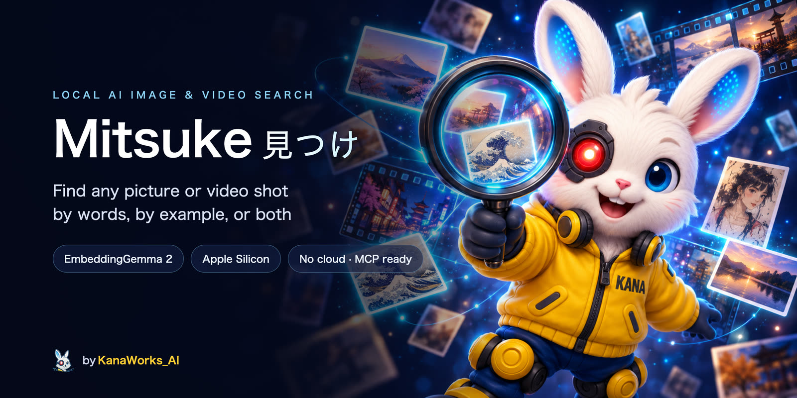
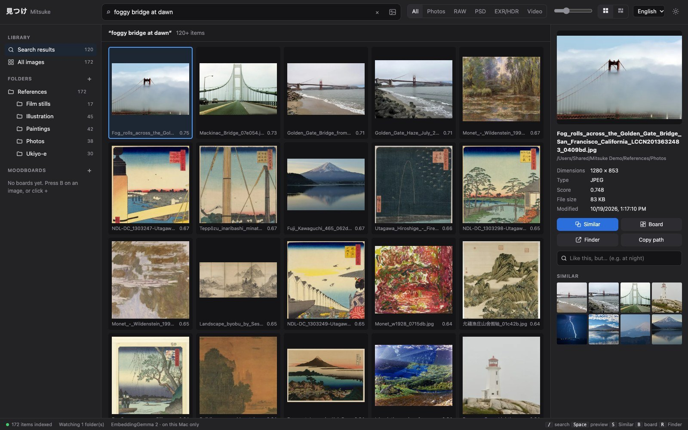
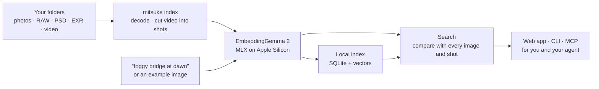

<div align="center">



<p>
  <a href="LICENSE"></a>
  
  <a href="https://modelcontextprotocol.io"></a>
  
  <a href="https://github.com/kanaworksai-hue/mitsuke/actions/workflows/tests.yml"></a>
  <a href="https://github.com/kanaworksai-hue/mitsuke/stargazers"></a>
</p>

<p><a href="https://github.com/kanaworksai-hue"></a>&nbsp;<a href="https://github.com/kanaworksai-hue"><b>A KanaWorks_AI project</b></a></p>

**English** | [简体中文](README.zh-CN.md) | [日本語](README.ja.md)

[Quick start](#-quick-start) · [Use it from your agent](#-use-it-from-your-agent) · [Web app](#%EF%B8%8F-the-web-app) · [Commands](#-commands) · [FAQ](#-faq) · [⭐ Star](#-like-it-star-it)

</div>

**Mitsuke 見つけ** (Japanese for "find") is a local AI image and video search tool for artists, illustrators and filmmakers. Describe a picture in English, Japanese, Chinese or many other languages ("foggy bridge at dawn", "雪の中の鳥居", "云雾缭绕的水墨山水"), or show it another picture ("like this, but at night"). Mitsuke finds it in your own folders: photos, camera RAW, PSD, EXR / HDR, and the right shot inside your videos. It runs entirely on your Mac using Google's [EmbeddingGemma 2](https://huggingface.co/google/embeddinggemma-2), so your images never leave your computer.

Use it in a local web app, from the command line, or let your AI agent (Claude Code, Codex, Cursor, …) search for you through MCP.

<p align="center">
  
  <br><sub>The web app searching a reference library of public-domain images. Ukiyo-e bridges show up next to the photos: the search goes by what is in the picture, not by file name.</sub>
</p>

## ✨ Highlights

<table>
<tr>
<td align="center" width="25%">🔎<br><b>Search by meaning</b><br><sub>Words, an example image, or both, with a slider to balance them</sub></td>
<td align="center" width="25%">🎞️<br><b>Made for real libraries</b><br><sub>RAW, PSD / PSB, EXR / HDR, HEIC, and videos searched shot by shot</sub></td>
<td align="center" width="25%">🤖<br><b>Agent-ready</b><br><sub>MCP server, JSON CLI and a skill, so your agent can find images and video shots and show them to you</sub></td>
<td align="center" width="25%">🔒<br><b>Local</b><br><sub>Runs on Apple Silicon with MLX. No account, no upload, no API key</sub></td>
</tr>
</table>

- **Keeps up with your folders:** while the web app or `mitsuke index --watch` is running, new and changed files are indexed automatically. Moved and renamed files are recognized and keep their index entries.
- **Moodboards:** collect results on moodboards, then use a whole moodboard as your query.
- **Never touches your files:** Mitsuke only reads them. The index and thumbnails are stored in separate folders.

## 🧭 How it works



Images and words are mapped into the same embedding space, so a sentence, a picture, or a mix of both can be compared with every image and video shot in your library.

## 🚀 Quick start

**Requirements:**

- Apple Silicon Mac (M1 or later)
- [`uv`](https://docs.astral.sh/uv/) (`brew install uv`). It installs Python for you.
- About 4 GB of free disk space: the model is about 1.5 GB, and the packages and the index take the rest

> [!TIP]
> **Let your agent install it.** Paste this into Claude Code, Codex or another coding agent:
> *"Install Mitsuke from https://github.com/kanaworksai-hue/mitsuke by following its INSTALL.md."*
>
> The agent follows [`INSTALL.md`](INSTALL.md): it checks your Mac, installs the `mitsuke` command, downloads the model, asks which folders to index, chooses between the CLI and the MCP server, installs the skill and tells you how to open the web app.

To install it yourself:

```bash
uv tool install "mitsuke @ git+https://github.com/kanaworksai-hue/mitsuke"
mitsuke doctor --download      # checks the setup and downloads the model (once)
mitsuke serve --open           # the web app at http://127.0.0.1:8737; add folders there
```

Or skip the web app and do it all from the command line:

```bash
mitsuke add ~/Pictures/References ~/Work/Concept
mitsuke index                  # safe to stop with Ctrl-C; run it again to resume
mitsuke search "雪の中の鳥居"
mitsuke similar ~/Desktop/this_composition.jpg
```

## 🤖 Use it from your agent

Once it is installed, just ask: *"find the foggy harbor photos in my Japan trip folder"*, *"collect references for a candle-lit interior and put the best ones on a moodboard"*, *"find the shot in my videos where the dragon appears"*. The agent uses one of these:

- **MCP server:** `mitsuke mcp` (stdio). The model stays loaded after the first call, so later searches are fast.

  ```bash
  claude mcp add --scope user mitsuke -- "$(command -v mitsuke)" mcp   # Claude Code
  codex mcp add mitsuke -- "$(command -v mitsuke)" mcp                 # Codex
  ```

  Tools: `search` (words, example images, a moodboard, or a mix), `similar`, `view_images` (a contact sheet the agent can look at), `file_info`, `open_file`, seven moodboard tools, `status`, `add_folder`, `remove_folder`, `index`, `web_link`.
- **CLI:** every command takes `--json`, for example `mitsuke search "at night" --like 12 --json`.
- **Skill:** `mitsuke skill install` puts a skill in `~/.claude/skills/mitsuke`. It tells the agent when to use Mitsuke and how to show you results, with a link that opens the same search in the web app.

<details>
<summary><b>Claude Desktop, Cursor and other MCP clients</b></summary>

Use the absolute path of the command (desktop apps don't search your shell's `PATH`):

```json
{ "mcpServers": { "mitsuke": { "command": "/Users/<you>/.local/bin/mitsuke", "args": ["mcp"] } } }
```

If you set `HF_HOME` or `MITSUKE_HOME` in your shell, pass them in an `"env"` block too, so the server finds the downloaded model and your index.
</details>

## 🖼️ The web app

`mitsuke serve --open` starts it. It only listens on `127.0.0.1` and keeps the index up to date while it runs. The interface is in English, Japanese and Chinese, with dark and light themes.

- **One search box for everything:** type in any language (your usual dictation tool works too), or drop, paste or pick an image. Images and words combine ("this composition" + "at night"), with a slider to balance the two.
- **Video:** each video is split into shots. A search lands on the matching shot and plays it from there.
- **Moodboards:** drag results onto a moodboard (or press <kbd>B</kbd>), then use the whole moodboard as your query.
- **Built for daily work:** a square grid or rows that keep each image's shape, a size slider, full-screen preview (<kbd>Space</kbd>), arrow keys, <kbd>S</kbd> for similar images, <kbd>R</kbd> to reveal in Finder, and filters by folder and file type. In Chrome or Edge, drag a result to Finder to get a copy of the original file.

## 📋 Commands

| Command | What it does |
|---|---|
| `mitsuke add <folder>…` / `remove <folder>…` / `roots` | Manage library folders (removing never touches your files) |
| `mitsuke index [--watch] [--quality fast\|default\|best]` | Index new and changed files. `--watch` keeps running and follows changes |
| `mitsuke search "<text>" [-k 20] [--root F] [--kind raw,psd,exr,video]` | Find images and video shots by description |
| `mitsuke search ["<text>"] [--like <image>…] [--board ID] [--text-weight 0.5]` | Image + words ("like this, but at night"), or a whole moodboard as the query |
| `mitsuke similar <image or id>` | Find images that look like an image (inside or outside the library) |
| `mitsuke board list\|create\|show\|add\|remove\|rename\|delete` | Moodboards (shared with the web app) |
| `mitsuke show <image or id> [--open\|--reveal]` | Details of one file; open it or show it in Finder |
| `mitsuke web ["<text>"] [--board ID] [--start] [--open]` | A link that opens a search or a moodboard in the web app (`--start` launches the app in the background) |
| `mitsuke serve [--port 8737] [--open] [--no-index]` | The web app (local only); indexes and watches folders in the background |
| `mitsuke mcp` | MCP server on stdin/stdout for AI agents |
| `mitsuke skill install [--dir D]` | Install the agent skill (default `~/.claude/skills`) |
| `mitsuke status` | What is indexed, pending and failed |
| `mitsuke doctor [--download]` | Check Python, decoders, model, disk and folders |

Every command accepts `--json` for agents and scripts (`index` prints one JSON event per line).

<details>
<summary><b>Supported formats</b></summary>

JPEG, PNG, WebP, HEIC / HEIF, AVIF, TIFF (including 16-bit), GIF, BMP, TGA, JPEG 2000, PSD / PSB, camera RAW (CR2, CR3, NEF, ARW, RAF, ORF, RW2, DNG and more), OpenEXR and Radiance HDR (tone-mapped for search), and video (MP4, MOV, M4V, MKV, WebM, AVI, searched shot by shot).
</details>

<details>
<summary><b>Where the data lives</b></summary>

- Index: `~/Library/Application Support/Mitsuke`
- Thumbnails: `~/Library/Caches/Mitsuke`
- Model: the Hugging Face cache (`~/.cache/huggingface`, or `$HF_HOME` if set)

Set `MITSUKE_HOME=<folder>` to keep the index and thumbnails somewhere else.
</details>

## ❓ FAQ

<details>
<summary><b>Does anything get uploaded?</b></summary>

No. Your images, searches and index stay on your Mac. Installing downloads the Python packages, and the model is downloaded once from Hugging Face. After that, the Hugging Face library checks for model updates when it loads the model; set `HF_HUB_OFFLINE=1` to turn that off. The web app only listens on `127.0.0.1`.
</details>

<details>
<summary><b>Does it run on Windows, Linux or Intel Macs?</b></summary>

Not yet. It needs an Apple Silicon Mac, because the model runs on [MLX](https://github.com/ml-explore/mlx).
</details>

<details>
<summary><b>Which languages can I search in?</b></summary>

EmbeddingGemma 2 is multilingual. English, Japanese and Chinese all work well, and you can mix them. To search by voice, use your Mac's dictation or any voice input tool.
</details>

<details>
<summary><b>Can it search the audio or the dialogue in my videos?</b></summary>

No. Videos are searched by what is on screen, shot by shot.
</details>

<details>
<summary><b>CLI or MCP, which should my agent use?</b></summary>

MCP, if your agent's app supports it and you search often: the model stays loaded (a few GB of memory while the session is open). The CLI loads the model on each call (a few seconds) but leaves nothing running. [`INSTALL.md`](INSTALL.md) has the full checklist the agent uses to decide.
</details>

## 🗺️ Roadmap

- [x] Text, image and image + text search; video shots; EXR / HDR
- [x] Web app, CLI, MCP server and agent skill
- [ ] Filter by color
- [ ] Index ComfyUI / Automatic1111 prompts stored in PNG files
- [ ] Export moodboards

Issues and pull requests are welcome.

## ⭐ Like it? Star it

If Mitsuke found an image or shot you needed, please click **⭐ Star** at the top of the [repository page](https://github.com/kanaworksai-hue/mitsuke). It's free, takes a second, and helps more than you might think:

- **More people find it.** Stars make the project easier to discover on GitHub, so more artists and filmmakers get to use it.
- **It keeps the project going.** Every star shows that people find Mitsuke useful, and that's what keeps new features coming.

Other ways to help: [open an issue](https://github.com/kanaworksai-hue/mitsuke/issues) for a bug or an idea, or share how you use it on X and tag [@KanaWorks_AI](https://x.com/KanaWorks_AI).

## 🛠️ Development

```bash
uv sync
uv run pytest              # offline tests with a fake embedder; no model or GPU needed
uv run pytest -m model     # checks with the real model
uv run mitsuke serve       # run from the checkout
```

```
src/mitsuke/
  cli.py        commands (argparse, --json everywhere)
  indexer.py    scan → embed, resumable; moves and renames keep their vectors
  search.py     cosine search, image + text fusion, filters
  server.py     the local web app (standard library HTTP server)
  mcp.py        the MCP server (stdio JSON-RPC)
  video.py      shot detection and shot thumbnails
  decode.py     RAW / PSD / EXR / HDR / HEIC previews
  web/          the web app (plain JS, no build step)
  skill/        the agent skill
```

## 📄 License and credits

- **This project:** [MIT](LICENSE).
- **Model:** [EmbeddingGemma 2](https://huggingface.co/google/embeddinggemma-2) by Google, licensed under Apache 2.0. It is downloaded from Hugging Face ([MLX conversion](https://huggingface.co/mlx-community/embeddinggemma-2-bf16)), not distributed here.
- **Built on:** [MLX](https://github.com/ml-explore/mlx), [mlx-vlm](https://github.com/Blaizzy/mlx-vlm), [OpenCV](https://opencv.org), [Pillow](https://python-pillow.org), [rawpy](https://github.com/letmaik/rawpy), [psd-tools](https://github.com/psd-tools/psd-tools) and the [Model Context Protocol](https://modelcontextprotocol.io).
- **Screenshots:** the images in the demo library are public-domain and CC0 works from Wikimedia Commons ([list](docs/assets/demo-credits.md)).
- **Brand:** the KanaWorks_AI name, logo and the Kana character are © KanaWorks_AI and are **not** covered by the MIT license. See [docs/brand](docs/brand/README.md).

This is an independent project. It is not affiliated with or endorsed by Google, Apple or Anthropic.

<br>

<div align="center">

<a href="https://x.com/KanaWorks_AI"></a>

<p><b>Made with ♥ by <a href="https://x.com/KanaWorks_AI">KanaWorks_AI</a></b></p>

<p><sub>If Mitsuke saves you time, a ⭐ helps the project keep going and helps others find it. More projects: <a href="https://github.com/kanaworksai-hue">github.com/kanaworksai-hue</a></sub></p>

</div>
