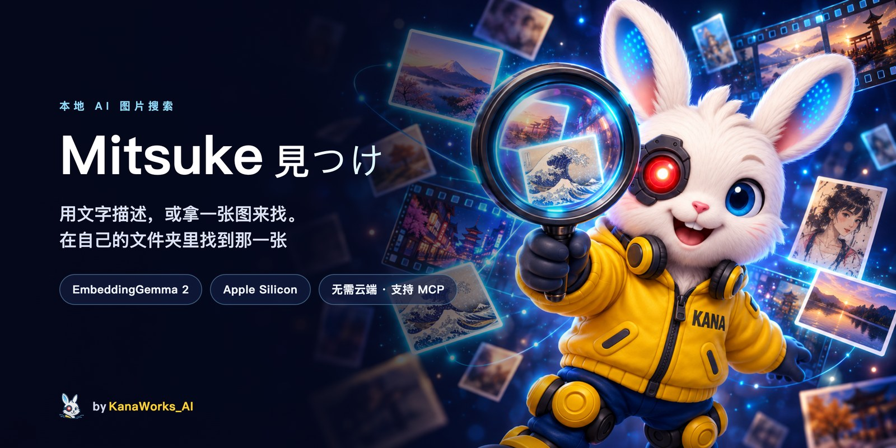
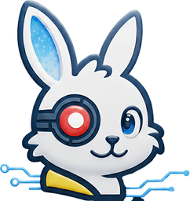
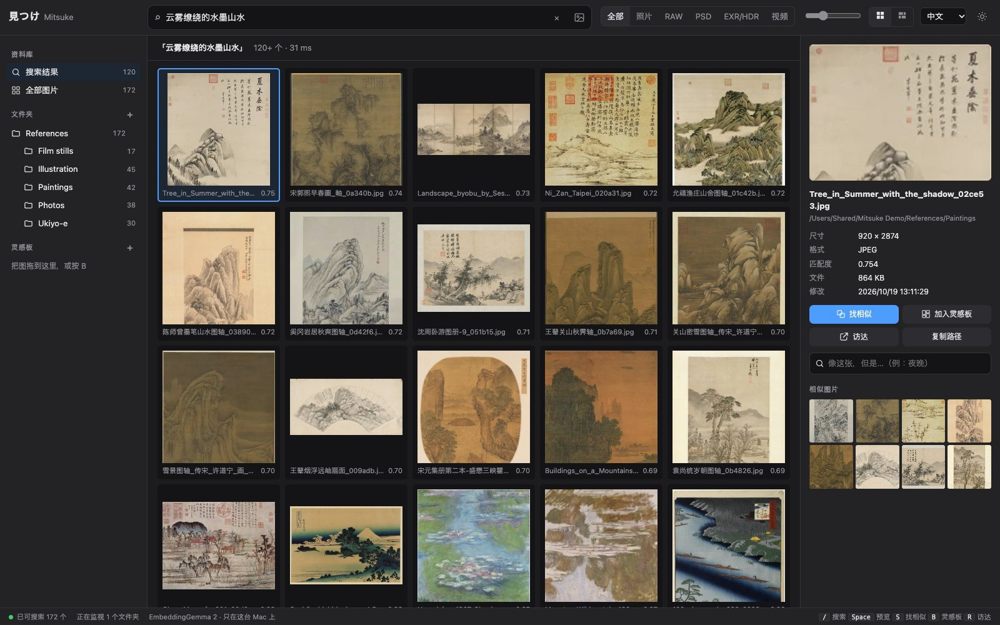
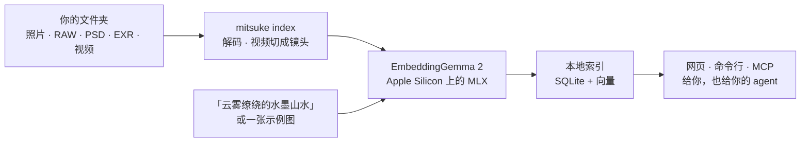

<div align="center">



<p>
  <a href="LICENSE"></a>
  
  <a href="https://modelcontextprotocol.io"></a>
  
  <a href="https://github.com/kanaworksai-hue/mitsuke/actions/workflows/tests.yml"></a>
  <a href="https://github.com/kanaworksai-hue/mitsuke/stargazers"></a>
</p>

<p><a href="https://github.com/kanaworksai-hue"></a>&nbsp;<a href="https://github.com/kanaworksai-hue"><b>A KanaWorks_AI project</b></a></p>

[English](README.md) | **简体中文** | [日本語](README.ja.md)

[快速开始](#-快速开始) · [让 agent 来用](#-让-agent-来用) · [网页](#%EF%B8%8F-网页) · [命令](#-命令) · [常见问题](#-常见问题) · [⭐ Star](#-喜欢就点个-star)

</div>

**Mitsuke 見つけ**（日语「找到了」）是给画师、美术和影视工作者用的本地 AI 图片搜索。用任何语言描述一张图（「云雾缭绕的水墨山水」「foggy bridge at dawn」「雪の中の鳥居」），或者拿一张图来找（「像这张，但是夜晚」），Mitsuke 就能在你自己的文件夹里找到它：照片、相机 RAW、PSD、EXR / HDR，还有视频里对应的那个镜头。模型是 Google 的 [EmbeddingGemma 2](https://huggingface.co/google/embeddinggemma-2)，在你的 Mac 上运行，图片不会离开这台电脑。

可以用本地网页、命令行，也可以通过 MCP 让你的 AI agent（Claude Code、Codex、Cursor 等）帮你找。

<p align="center">
  
  <br><sub>在一个用公有领域图片搭的参考图库里搜索。水墨山水的立轴、册页、屏风都被找了出来：搜索看的是画面内容，不是文件名。</sub>
</p>

## ✨ 亮点

<table>
<tr>
<td align="center" width="25%">🔎<br><b>按意思找</b><br><sub>任何语言的文字、一张示例图，或者两者一起，用滑块调比重</sub></td>
<td align="center" width="25%">🎞️<br><b>适合真实的素材库</b><br><sub>RAW、PSD / PSB、EXR / HDR、HEIC，视频按镜头搜索</sub></td>
<td align="center" width="25%">🤖<br><b>agent 能直接用</b><br><sub>MCP 服务、JSON 输出的命令行和 skill，agent 能帮你找图、给你看</sub></td>
<td align="center" width="25%">🔒<br><b>完全本地</b><br><sub>在 Apple Silicon 上用 MLX 运行。不用账号、不用上传、不用 API key</sub></td>
</tr>
</table>

- **跟得上文件夹的变化：** 新增、修改、移动、改名都会更新。移动和改名会被认出来，不会重新建索引。
- **灵感板：** 把结果收进灵感板，再搜「和这块板相似的」。
- **不碰你的文件：** Mitsuke 只读取。索引和缩略图放在单独的文件夹里。

## 🧭 原理



图片和文字在同一个向量空间里，所以一句话、一张图或两者的组合，都能和图库里的每张图比较。

## 🚀 快速开始

**需要：**

- Apple Silicon 的 Mac（M1 或更新）
- [`uv`](https://docs.astral.sh/uv/)（`brew install uv`），它会自带 Python
- 约 4 GB 空闲磁盘：模型约 1.5 GB，其余是依赖包和索引

> [!TIP]
> **让 agent 帮你装。** 把这句话发给 Claude Code、Codex 等编程 agent：
> *「按照 https://github.com/kanaworksai-hue/mitsuke 的 INSTALL.md 帮我安装 Mitsuke」*
>
> agent 会按 [`INSTALL.md`](INSTALL.md) 操作：检查你的 Mac、安装 `mitsuke` 命令、下载模型、问你要索引哪些文件夹、自己决定用命令行还是 MCP 服务、装好 skill，最后告诉你怎么打开网页。

自己安装：

```bash
uv tool install "mitsuke @ git+https://github.com/kanaworksai-hue/mitsuke"
mitsuke doctor --download      # 检查环境并下载模型（只下载一次）
mitsuke serve --open           # 打开网页 http://127.0.0.1:8737，在网页里添加文件夹
```

或者只用命令行：

```bash
mitsuke add ~/Pictures/References ~/Work/Concept
mitsuke index                  # 可以随时 Ctrl-C 停下，再运行会接着做
mitsuke search "雪の中の鳥居"
mitsuke similar ~/Desktop/this_composition.jpg
```

## 🤖 让 agent 来用

装好以后直接说就行：「找去年旅行拍的雾中港口」「找烛光室内的参考，把最好的放进灵感板」「我视频里出现龙的那个镜头」。agent 会用下面其中一种方式：

- **MCP 服务：** `mitsuke mcp`（stdio）。模型在两次调用之间一直保持加载，所以第一次之后的搜索很快。

  ```bash
  claude mcp add --scope user mitsuke -- "$(command -v mitsuke)" mcp
  ```

  工具：`search`（文字、示例图、灵感板或组合）、`similar`、`view_images`（agent 能看的缩略图拼图）、`file_info`、`open_file`、灵感板相关工具、`status`、`add_folder`、`remove_folder`、`index`、`web_link`。
- **命令行：** 每个命令都支持 `--json`，例如 `mitsuke search "at night" --like 12 --json`。
- **Skill：** `mitsuke skill install` 会把 skill 装到 `~/.claude/skills/mitsuke`，告诉 agent 什么时候用 Mitsuke、怎么把结果给你看（附带在网页里打开同一个搜索的链接）。

<details>
<summary><b>Claude Desktop、Cursor 等 MCP 客户端</b></summary>

命令要写绝对路径（桌面应用不读 shell 的 `PATH`）：

```json
{ "mcpServers": { "mitsuke": { "command": "/Users/<you>/.local/bin/mitsuke", "args": ["mcp"] } } }
```

如果你在 shell 里设了 `HF_HOME` 或 `MITSUKE_HOME`，也要在 `"env"` 里写上同样的值，服务才能找到已下载的模型和你的索引。
</details>

## 🖼️ 网页

用 `mitsuke serve --open` 打开。它只监听 `127.0.0.1`，开着的时候会保持索引是最新的。界面有中文、日文、英文，深色和浅色两种主题。

- **一个搜索框搞定：** 用任何语言输入（也可以用你自己的语音输入法），或者拖入、粘贴、选择一张图片。图片和文字可以组合（「这个构图」+「夜晚」），用滑块调两者的比重。
- **视频：** 每个视频按镜头切开。搜索会直接定位到对应的镜头，从那里开始播放。
- **灵感板：** 把结果拖到灵感板上（或按 <kbd>B</kbd>），再用整块板去搜相似的。
- **为干活设计：** 方形网格或按原比例排行、大小滑块、全屏预览（<kbd>Space</kbd>）、方向键、<kbd>S</kbd> 找相似、<kbd>R</kbd> 在访达中显示。把结果拖进 Photoshop 或访达，得到的是原文件。可以按文件夹和类型筛选。

## 📋 命令

| 命令 | 作用 |
|---|---|
| `mitsuke add <folder>…` / `remove <folder>` / `roots` | 管理图库文件夹（移除不会动你的文件） |
| `mitsuke index [--watch] [--quality fast\|default\|best]` | 索引新增和修改的图片。`--watch` 持续运行，跟着文件变化更新 |
| `mitsuke search "<text>" [-k 20] [--root F] [--kind raw,psd,exr,video]` | 用文字找图片（和视频镜头） |
| `mitsuke search ["<text>"] --like <image> [--board ID] [--text-weight 0.5]` | 图片 + 文字（「像这张，但是夜晚」），或用整块灵感板来搜 |
| `mitsuke similar <image or id>` | 找看起来相似的图片（图库外的图片也可以） |
| `mitsuke board list\|create\|show\|add\|remove\|rename\|delete` | 灵感板（和网页共用） |
| `mitsuke show <image or id> [--open\|--reveal]` | 一个文件的详情；打开它或在访达中显示 |
| `mitsuke web ["<text>"] [--board ID] [--start] [--open]` | 打开某个搜索或灵感板的网页链接（`--start` 在后台启动网页） |
| `mitsuke serve [--port 8737] [--open] [--no-index]` | 网页（只在本机）；在后台索引并监视文件夹 |
| `mitsuke mcp` | 给 AI agent 用的 MCP 服务（stdin/stdout） |
| `mitsuke skill install [--dir D]` | 安装 agent skill（默认 `~/.claude/skills`） |
| `mitsuke status` | 已索引、待处理、失败的数量 |
| `mitsuke doctor [--download]` | 检查 Python、解码器、模型、磁盘和文件夹 |

每个命令都支持 `--json`，方便 agent 和脚本使用（`index` 每行输出一个 JSON 事件）。

<details>
<summary><b>支持的格式</b></summary>

JPEG、PNG、WebP、HEIC / HEIF、AVIF、TIFF（含 16 位）、GIF、BMP、JPEG 2000、PSD / PSB、相机 RAW（CR2、CR3、NEF、ARW、RAF、ORF、RW2、DNG 等）、OpenEXR 和 Radiance HDR（色调映射后搜索），以及视频（MP4、MOV、M4V、MKV、WebM、AVI，按镜头搜索）。
</details>

<details>
<summary><b>数据放在哪里</b></summary>

- 索引：`~/Library/Application Support/Mitsuke`
- 缩略图：`~/Library/Caches/Mitsuke`
- 模型：Hugging Face 缓存（`~/.cache/huggingface`）

设置 `MITSUKE_HOME=<folder>` 可以把索引和缩略图放到别处。
</details>

## ❓ 常见问题

<details>
<summary><b>会上传什么东西吗？</b></summary>

不会。模型在你的 Mac 上运行。唯一的下载是第一次从 Hugging Face 下载模型。网页只监听 `127.0.0.1`。
</details>

<details>
<summary><b>能在 Windows、Linux 或 Intel Mac 上用吗？</b></summary>

暂时不行。模型用 [MLX](https://github.com/ml-explore/mlx) 运行，需要 Apple Silicon 的 Mac。
</details>

<details>
<summary><b>能用哪些语言搜索？</b></summary>

EmbeddingGemma 2 是多语言模型。中文、日文、英文都能搜得很好，混着用也没问题。想用语音搜索的话，用 Mac 自带的听写或任何语音输入工具就行。
</details>

<details>
<summary><b>能按视频里的声音或台词搜索吗？</b></summary>

不能。视频按画面内容、逐个镜头搜索。
</details>

<details>
<summary><b>agent 应该用命令行还是 MCP？</b></summary>

如果客户端支持 MCP，而且你会经常搜，就用 MCP：模型会一直保持加载。命令行每次调用都要重新加载模型（几秒），但不会有常驻进程。agent 做选择用的完整标准在 [`INSTALL.md`](INSTALL.md) 里。
</details>

## 🗺️ 路线图

- [x] 文字、图片、图片 + 文字搜索；视频镜头；EXR / HDR
- [x] 网页、命令行、MCP 服务和 agent skill
- [ ] 按颜色筛选
- [ ] 索引 PNG 里保存的 ComfyUI / Automatic1111 提示词
- [ ] 导出灵感板

欢迎提 Issue 和 Pull Request。

## ⭐ 喜欢就点个 Star

如果 Mitsuke 帮你找到了需要的图，请在[仓库页面](https://github.com/kanaworksai-hue/mitsuke)顶部点一下 **⭐ Star**。免费、只要一秒，帮助比看起来大得多：

- **让更多人发现它。** Star 越多，在 GitHub 上越容易被找到，就会有更多画师和影视工作者用上它。
- **让更新继续下去。** 每一个 Star 都在告诉我有人觉得它有用，这就是我继续做下一个功能的动力。

其他帮忙的方式：有 bug 或想法请[提 Issue](https://github.com/kanaworksai-hue/mitsuke/issues)，或者在 X 上分享你的用法并 @[KanaWorks_AI](https://x.com/KanaWorks_AI)。

## 🛠️ 开发

```bash
uv sync
uv run pytest              # 用假 embedder 的离线测试，不需要模型和 GPU
uv run pytest -m model     # 用真模型检查
uv run mitsuke serve       # 从源码目录运行
```

```
src/mitsuke/
  cli.py        命令（argparse，全部支持 --json）
  indexer.py    扫描 → 嵌入，可续跑；移动和改名保留原向量
  search.py     余弦搜索、图片 + 文字融合、筛选
  server.py     本地网页（标准库 HTTP 服务）
  mcp.py        MCP 服务（stdio JSON-RPC）
  video.py      切镜头和镜头缩略图
  decode.py     RAW / PSD / EXR / HDR / HEIC 预览
  web/          网页（原生 JS，无需构建）
  skill/        agent skill
```

## 📄 许可证和致谢

- **本项目：** [MIT](LICENSE)。
- **模型：** Google 的 [EmbeddingGemma 2](https://huggingface.co/google/embeddinggemma-2)，Apache 2.0 许可。从 Hugging Face 下载（[MLX 转换版](https://huggingface.co/mlx-community/embeddinggemma-2-bf16)），不在本仓库中分发。
- **基于：** [MLX](https://github.com/ml-explore/mlx)、[mlx-vlm](https://github.com/Blaizzy/mlx-vlm)、[OpenCV](https://opencv.org)、[Pillow](https://python-pillow.org)、[rawpy](https://github.com/letmaik/rawpy)、[psd-tools](https://github.com/psd-tools/psd-tools) 和 [Model Context Protocol](https://modelcontextprotocol.io)。
- **截图：** 演示图库里的图片是 Wikimedia Commons 上的公有领域和 CC0 作品（[清单](docs/assets/demo-credits.md)）。
- **品牌：** KanaWorks_AI 名称、logo 和 Kana 形象版权归 KanaWorks_AI 所有，**不在** MIT 许可范围内。见 [docs/brand](docs/brand/README.md)。

本项目是独立项目，与 Google、Apple、Anthropic 没有关联，也未获得其认可。

<br>

<div align="center">

<a href="https://x.com/KanaWorks_AI"></a>

<p><b>Made with ♥ by <a href="https://x.com/KanaWorks_AI">KanaWorks_AI</a></b></p>

<p><sub>如果 Mitsuke 帮你省了时间，一个 ⭐ 能让更新继续，也能让更多人发现它。更多项目：<a href="https://github.com/kanaworksai-hue">github.com/kanaworksai-hue</a></sub></p>

</div>
